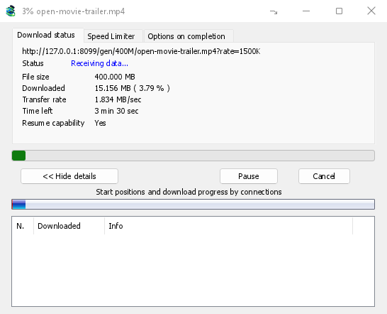
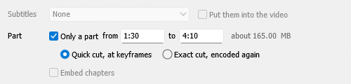
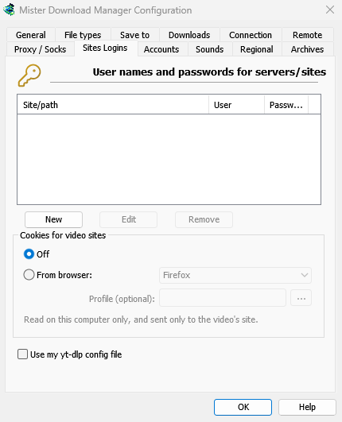

# Video downloads

[← Back to docs index](README.md)

MDM downloads videos from their web pages: YouTube, Vimeo, Dailymotion, Twitch, TikTok, X, Instagram, Facebook, Reddit, SoundCloud and well over a thousand other sites. **yt-dlp**, an open-source program whose community keeps it working as sites change, finds the video on the page; MDM's own downloader then brings it in, the way it downloads any file.

## Start a video download

- Give the video's page address to **Add URL** (**Ctrl+N**). MDM recognises video pages and opens the video window, already looking the page up.
- Or choose **Tasks → Download video from a page...**, paste the address into **Page address** and click **Look up**.

Any other page address that turns out to be a web page, not a file, is offered to the video window too. On a site yt-dlp has no reader of its own for, the video is the one the page says it is about, when it names one (in what it tells search engines and link previews: its JSON-LD, `og:video` or `twitter:player`), rather than the first player written in its HTML, and the file is named as the page names it.

<!-- steps -->

1. 
   *Paste the page's address and click Look up.*
2. 
   *Pick a quality, then Download Now.*
3. 
   *It downloads like any other file, in its own row and window.*

## yt-dlp and ffmpeg

MDM offers its two helpers on its first start, and again the first time they are needed. It
downloads them from their official releases with its own downloader, so a cut connection
resumes, and uses your proxy settings:

- **yt-dlp** (about 23 MB) looks the page up and finds where the video and its sound come from; MDM downloads them ([How a video comes down](#how-a-video-comes-down)). The first time, click **Install yt-dlp**. MDM checks the download against the signature yt-dlp's developers publish before it uses it.
- **ffmpeg** (about 80 MB) joins a video and its sound when a site keeps them apart, which most sites do for the higher qualities, and turns the sound into an MP3, Opus or FLAC file. Click **Install ffmpeg** when MDM offers it. MDM checks it against the checksums its release publishes.
- **Each processor gets its own build:** yt-dlp's for x64, ARM64 and 32-bit Windows and for Linux on ARM, and ffmpeg's for x64 and ARM64 Windows. No ffmpeg is built for 32-bit Windows that MDM can check, so there MDM offers none: choose your own in **Helpers...** (below), or download the qualities that come with their sound.

Both are kept in a `tools` folder in MDM's data folder. For YouTube, yt-dlp also needs a JavaScript runtime, which MDM can download too: see [A JavaScript runtime for YouTube](#javascript-runtime).

### Keeping them up to date {#helper-updates}

Sites change all the time, and a newer yt-dlp is usually what makes a page that stopped working download again. So MDM keeps its own copies of yt-dlp, gallery-dl, ffmpeg and Node.js up to date by itself:

- **When:** a few seconds after MDM starts, then again while it runs: yt-dlp and gallery-dl at most every 6 hours, Node.js once a day, ffmpeg once a week. MDM remembers when it last asked, so starting it many times doesn't ask again.
- **How:** each new version is downloaded and checked exactly as the first install was (yt-dlp's, gallery-dl's and Node.js's signed checksum lists, ffmpeg's published checksums), never an older one, and installed beside the one in use.
- **When it switches:** only while no download, look-up or other run is using that helper. A video downloading when the new yt-dlp arrives finishes with the one it started with; the new one is used from the moment the last download using it ends.
- **The previous version stays**, so you can go back to it. Older ones are removed.
- **A video that fails** with an error that usually means yt-dlp is out of date for the site (*Unable to extract*, *Unsupported URL*, YouTube's *Sign in to confirm you're not a bot*, *HTTP Error 403*, a failed signature or *n challenge*, *Requested format is not available*), or a gallery whose gallery-dl reports an unexpected error: MDM looks for a newer version at once, installs it if there is one, and tries that download again with it, once. Its log says so. If there is none, the error stands as before.
- **A check that fails** (no connection, GitHub busy) is tried again an hour later. It is written in MDM's log, never shown as an error.

In **Helpers...**, each of MDM's own copies says how it stands: *Up to date*, *Version X available*, *Updated to X*, or *Version X is ready: used once its downloads end*. **Update** gets the newest version of that one now, **Go back to X** uses the previous version again (automatic updates then wait for a version newer than the one you left; **Update** brings it back), and **Check for updates** checks them all. Untick **Keep MDM's helpers up to date automatically** to update only when you ask. Programs you chose with **Use another program...**, and your system's copies, say *Updated by you*: MDM leaves them to you.

On the command line, `update-helpers` checks and updates them all and prints their versions ([Command line](command-line.md)).

### Use your own copies

On Linux and macOS, MDM finds yt-dlp, ffmpeg and gallery-dl on your `PATH` and in the usual package-manager folders, including Homebrew's. A program you selected yourself takes priority, followed by MDM's own installed copy. The system copy is used when neither is present, and your package manager keeps it up to date: MDM never downloads over it on its own. If your distribution's yt-dlp is old, **Use MDM's own copy** in Helpers downloads MDM's, which keeps itself current and is used from then on.

Already have yt-dlp or ffmpeg for another program? Use those instead of a second copy: in **Download video from a page**, click **Helpers...**, then **Use another program...** beside yt-dlp or ffmpeg, and choose the program. MDM runs it once to check that it is that program, and uses it from then on, the command line too. MDM doesn't update a program you chose: keep it up to date yourself (yt-dlp: `yt-dlp -U`, or your package manager). **Use MDM's own copy** goes back to the one MDM downloads and checks.

*Helpers...: use your own yt-dlp or ffmpeg instead.*

### A JavaScript runtime for YouTube {#javascript-runtime}

YouTube hides most of a video's qualities behind small puzzles that yt-dlp solves with a JavaScript runtime: **Node.js**, **Deno**, **QuickJS** or **Bun**. Without one, a look-up is slow, the list is short (sometimes only the sound and a low quality) or it fails with *Requested format is not available*, and MDM says so: *YouTube needs a JavaScript runtime to list its video qualities*. Other sites don't need one.

The quickest way is MDM's own copy of Node.js: click **Install Node.js** beside that message, or, in **Helpers...**, **Use MDM's own copy** in the **JavaScript runtime (for YouTube)** row. The first start's helpers window offers it too, when your computer has no runtime. MDM downloads Node.js's newest long-term support (LTS) build for your system and processor from [nodejs.org](https://nodejs.org) with its own downloader (about 40 MB on Windows, 60 MB on Linux and macOS; Windows x64, ARM64 and 32-bit, Linux x64 and ARM64, macOS), checks the release's checksum list against the signing keys of Node.js's releasers and the download against that list before it uses it, keeps only the `node` program in the `tools` folder beside yt-dlp and ffmpeg, and from then on tells yt-dlp to use it. It keeps it up to date the way it keeps yt-dlp's ([Keeping them up to date](#helper-updates)), never with an older version. 32-bit Windows gets the newest LTS line Node.js still builds for it, 22, which Node.js supports until April 2027; after that MDM has no Node.js for 32-bit Windows, and a runtime of your own (**Use another program...**) is needed there. MDM never installs a Node.js older than the LTS line current when that MDM was made, whatever nodejs.org's list says. The video is looked up again by itself once Node.js is in.

Already have one? Then nothing needs downloading: a runtime on your computer comes first. MDM finds Deno, Node.js (22 or newer, also one installed with nvm), QuickJS and Bun by itself, in the order yt-dlp prefers them, and passes over one too old for yt-dlp (Node.js 20, say) or a Node.js whose line has reached its end of life on nodejs.org's schedule (then MDM's own is used, which it keeps on a supported release). A supported Node.js of your computer's is used as it is: you or your package manager keep it up to date. Helpers says which one yt-dlp uses and where it is: *Node.js 24.11.0, your system's, nothing to download*. To use another one, a portable copy or one that isn't on the `PATH`, click **Use another program...** in that row and choose its program (`node.exe`, `deno.exe`, `qjs.exe`, `bun.exe`): MDM asks it for its version first and refuses one yt-dlp can't use. **Use MDM's own copy** goes back to the one MDM finds or downloads. (Choosing your own runtime was [YairDies](https://github.com/YairDies)' idea.)

Earlier versions of MDM installed Deno. That copy keeps working until MDM's Node.js is in place (the next update check brings it, or **Use MDM's own copy**); then yt-dlp switches to Node.js and MDM removes its own Deno, once no download is using it. A Deno you installed yourself is never touched, nor MDM's own once you chose it with **Use another program...**. While MDM asks the runtimes on your computer for their versions, Helpers says *Looking for a JavaScript runtime on this computer...*.

If you'd rather install one yourself, any of them works; then look the video up again. If MDM still says so, the new program's folder isn't on the `PATH` MDM started with (Windows' installers add it for programs started after them): quit MDM (**Tasks → Exit**) and start it again.

- **Windows**: `winget install DenoLand.Deno`, or `winget install OpenJS.NodeJS.LTS`. The installers on [deno.com](https://deno.com) and [nodejs.org](https://nodejs.org) work too.
- **Ubuntu and Debian**: `sudo apt install nodejs`
- **Fedora**: `sudo dnf install nodejs`
- **Arch**: `sudo pacman -S nodejs`, or `sudo pacman -S deno`
- **macOS**: `brew install deno`, or `brew install node`
- **Any system**, Deno for your user alone: `curl -fsSL https://deno.land/install.sh | sh` (on Windows, in PowerShell: `irm https://deno.land/install.ps1 | iex`)

A distribution's yt-dlp can also be too old for YouTube: if the list stays short, click **Use MDM's own copy** beside yt-dlp in **Helpers...**. A yt-dlp older than 2025.11.12 can't be told of a runtime at all; MDM then leaves the runtime out rather than stop the look-up.

## Choose the quality

1. Wait for the list. It shows each quality with its size, best first, then the sound alone:
   - A video's line says its resolution, the file it makes, its picture's codec, its frame rate and whether it is HDR: `2160p MP4 · AV1 · 60 fps · HDR`. MP4 is only the file: what's inside it can be AV1, VP9 or H.264, and the codec says which, the very one that downloads (should the site no longer offer that stream, MDM takes the nearest of the same codec and resolution first). A resolution that comes in several (AV1, VP9 and H.264, HDR and SDR) has a line for each: AV1 makes the smallest file, H.264 plays on the most devices, and an HDR video looks washed out on a screen without HDR. `SDR` is said only beside an HDR line of the same resolution.
   - **Most compatible (H.264 + AAC)**, second in the list: the best H.264 video the site has (YouTube's usually go up to 1080p) with AAC sound (in stereo when the site has it beside surround), in an MP4 that Premiere Pro and other editors, older TVs and most phones open as it is. YouTube's best qualities are AV1 or VP9 with Opus sound, which some of them can't read. The line says its resolution: `Most compatible (H.264 + AAC) · 1080p`. MDM picks those streams, it doesn't convert anything: when the site has no H.264 video with AAC sound the line isn't there, and when the best line already is that, it isn't listed twice.
   - The size is that of exactly what downloads, the video and its sound. A size with `~` before it (`~532 MB`) is only an estimate: the site didn't say the size, so it comes from the stream's bitrate and length.
   - **Audio only, original**: the site's own file, not converted, once for each type the site has it in (WebM with Opus inside, M4A), the best first. The best sound there is, in the smallest file.
   - **Audio only MP3** at its best variable bitrate (VBR) and at 320, 256, 192 and 128 kbps, for players that only take MP3.
   - **Audio only OPUS**: an `.opus` file. When the site's sound is Opus already (YouTube's usually is), it's only moved into that file, not converted, so nothing is lost.
   - **Audio only FLAC**: a lossless `.flac` file, for a library or a program that wants FLAC. It can't add quality: the site's sound is already compressed with losses, and FLAC keeps it exactly as it came, in a file several times bigger. The window says so when you choose it.
2. Pick one. Without ffmpeg, only the qualities that come with their sound are listed, and no MP3, Opus or FLAC (ffmpeg makes them).
3. Check **Save to** (the Video category's folder by default) and **File name**, which comes from the video's title. A long title is shortened, at the end of a word, so that the files saved beside the video while it downloads fit the system's limit on a path's length; a name you type is kept as you typed it.
4. Choose **Subtitles** if you want them (see below). **Embed chapters** is ticked: see [Chapters](#chapters). To keep only a stretch of it, tick **Only a part**: see [Download only a part](#part).
5. Click **Download Now**, or **Later** to add it to the list without starting.

The video then downloads like any other file, with its own row in the list and its progress window.

## How a video comes down

yt-dlp looks the page up and picks the quality's video and sound. MDM's own downloader then brings each of them in, one after the other, the way it downloads any file:

- **Over several connections**: as many as **Options → Connection** gives a file. The progress window's connections table shows each one, and the segment map shows the video and then its sound.
- **A stream sent in many small pieces** (HLS, DASH, as most sites other than YouTube send theirs) comes down that many pieces at once, each kept on disk as it arrives, then joined in order into one file, as yt-dlp joins them. Pieces encrypted with AES-128 are decrypted with the key the stream's playlist names. When their addresses expire, MDM asks yt-dlp for the stream's new list and carries on with the pieces still missing.
- **Under your speed limits**: the **Speed Limiter**'s, the video's own (its progress window's **Speed Limiter** tab), and the limit for all downloads together. A change applies at once.
- **Paused and resumed** like a file, also after quitting MDM: it carries on from the bytes already saved.
- **When an address stops working**: a video's addresses are signed and expire after a few hours (YouTube's after six). MDM asks yt-dlp for a fresh one for the same quality and carries on from where it stopped.

Then yt-dlp does what it does after a download: it joins the video and its sound with ffmpeg into one MP4, saves or embeds the subtitles, puts the chapters into the file, and converts the sound for an MP3, Opus or FLAC choice.

YouTube serves each connection's long requests slowly, so MDM asks for the video in pieces of 10 MB at most, as yt-dlp does, and several at once.

Some videos yt-dlp still downloads by itself, over its own connection, and the progress window says so:

- a live stream still being recorded ([Recording a live stream](#recording-a-live-stream));
- a stream sent over RTMP, RTSP, MMS or FTP;
- the rare streams in pieces of other kinds (Adobe's HDS, Microsoft's Smooth Streaming), and one whose key the site hands yt-dlp directly.

For those, a new speed limit starts the download again with it, from where it was ([Speed limits](#speed-limits)); a live stream that is recording takes it the next time it starts.

### Recording a live stream {#recording-a-live-stream}

A live stream, a broadcast still going on, is recorded by yt-dlp with ffmpeg into an unfinished file, so MDM can't know its length. While it records, the progress window says **Recording...**, and **Downloaded** and **Transfer rate** follow the size of what has been recorded so far.

- **Recording... shows from the moment the recorder opens its file**, once it has connected to the stream (a few seconds after the download starts; until then the window says **Connecting...**; a stream that can't be reached never gets there). **Downloaded** shows what has reached the disk, and the recorder writes it in blocks of 256 KB, so it stays at 0 KB until the first block is written (that can take a while on a stream of low bitrate), then grows block by block. **Stop and save** before the first block keeps nothing yet: the download is left stopped, with its empty file, for **Resume** to record anew. An empty unfinished file an earlier run left is removed when the recording starts again (it holds nothing), so a resumed recording shows **Recording...** from the same moment.
- **Stop and save** is what the progress window's pause button reads for a live stream that is recording. It, **Stop** and **Stop All** in the list (toolbar and menus), a queue's stop (by hand, at its scheduled stop time, or through the API) and the phone page's pause all end the recording and keep it. MDM makes the recording an MP4 itself, as yt-dlp does when a live stream ends: the streams are copied as they are, nothing is converted. The window says **Saving...** meanwhile, and the download is then **Complete**, as when a live stream ends by itself: the queue goes on and the completion notice and actions run.
- **The last moments may be missing:** at most the last 1 MiB the recorder hadn't written yet. That is a few seconds of video, and up to about a minute for a stream with sound only.
- **If the MP4 can't be made**, the recording is kept as an MPEG-TS file (`.ts`), which most players open. If that can't be done either, the download says so and the unfinished file stays as it is.
- **The recording is removed only when the MP4 holds all of it**: as long as the recording to within a second, its picture and its sound each too (ffprobe's durations; without them, at least 90 % of the recording's size). A shorter MP4 is kept with the recording beside it, as `My stream (recording 1).ts`, and the download's log says why (if the recording can't be renamed, the log says so: it stays as the unfinished file).
- **A recording in several parts** (a picture and a sound part yt-dlp left apart) is made one MP4 with all of them. If they can't be joined, the download says so and every part stays as it is.
- **Cancel** in the progress window only stops the download: the recording stays in its unfinished file. So does reaching a [download limit](queues-and-scheduler.md#download-limits), which counts a recording as it grows and stops it as it stops other downloads. **Resume**, or MDM starting the download again by itself (after a network adapter change or the download limit, or a queue that starts when MDM opens), records the stream anew. It first sets the earlier recording aside, next to it, as `My stream (recording 1).ts` (then `(recording 2)`, and so on), so nothing is recorded over; so it does when the stream has ended meanwhile and the download goes on as a normal video. (An unfinished MPEG-TS file yt-dlp downloads directly, without its resume state, is taken for a recording the same way: it starts over, what it had kept aside.) If that file can't be set aside, MDM doesn't record over it and says so.
- These kept recordings aren't the download's own files: **Delete** with its files leaves them.
- Closing MDM while a live stream records, or while it saves one, stops it without saving: the recording stays in its unfinished file (a half-made MP4 is left as `<name>.temp.mp4`, which **Delete** with its files removes), and it is set aside when the download starts again. The command line (`misterdownloadmanager-cli`) doesn't save a live stream this way.
- A live stream saved by a queue's stop counts as complete, so a daily queue doesn't start it again the next day.

## Subtitles

When the video has subtitles, the **Subtitles** list offers them: the uploader's own languages first (and **All the uploader's** when there are several), then the site's automatic captions, marked *automatic*. Of those, only the ones in the language spoken and their translations into English and your interface language are listed; sites like YouTube offer a machine translation into every language they know.

*Choose the subtitles; tick Put them into the video to keep them inside the file.*

- Saved beside the video, they get its name and the language: `My video.fr.srt`. Players such as VLC and MPV pick them up on their own. With ffmpeg they're always SRT; without it, the site's own format (often WebVTT, `.vtt`).
- **Put them into the video** puts them inside the file instead, as tracks you switch on in the player. It needs ffmpeg, and an MP4 or MKV video.
- A sound-only choice (**Audio only**, MP3, Opus, FLAC) has no subtitles.

MDM offers the same choice again for the next video when it has that language.

A site may refuse subtitles when it's asked too often: YouTube does, most of all for its translated captions. The video is saved all the same. MDM asks for the subtitles once more after 20 seconds, and if they still don't come, the **Download complete** window and the download's log say which ones are missing and why. Try them again later. When subtitles meant to go inside the video only come on that second try, they're saved beside it instead.

## Chapters

Many videos are split into chapters on their page: YouTube's list under the player, with a title and a start time for each part. With **Embed chapters** ticked, under **Subtitles**, they go into the video file, so players such as VLC, MPV, MPC-HC and Windows' Media Player list them and skip from one to the next.

- It's ticked to begin with, and stays as you leave it for the next video.
- It needs ffmpeg, which writes them. A video without chapters is saved as it is.
- They go into a video (MP4, MKV, WebM) and into the sound as the site has it (**Audio only, original**), not into an MP3, Opus or FLAC file.
- The command line (`video-get`) puts them in too, whenever ffmpeg is there.

## Download only a part {#part}

To save only a stretch of a video or of a sound (a scene, a song from a long mix, a few minutes of a podcast), tick **Only a part** on the **Part** row, under **Subtitles**, and type where it starts and where it ends.

*Only from 1:30 to 4:10, cut quickly; a part has no subtitles or chapters.*

- **Times** are typed as `1:30` (a minute and a half), `1:02:03` (an hour, two minutes and three seconds) or in seconds (`90`). The boxes start at the whole video, from 0:00 to its end; **Up** and **Down** move a time by a second, **Page Up** and **Page Down** by ten. A box turns red while its time can't be (it isn't a time, the end comes before the start, it's past the video's end, or the part is the whole video), and **Download Now** says why.
- **Quick cut, at keyframes**, the first choice: the picture and the sound are copied as they are, nothing is encoded again, so it's fast and loses nothing. A picture can only start cleanly at a keyframe, so the part starts at the last one before your start: a few seconds early at most, never late. A sound alone in an M4A starts where you say; in a WebM (Opus) at the last seek point before it, which can be ten seconds early.
- **Exact cut, encoded again**: the part starts and ends where you said. ffmpeg encodes it again (H.264 and AAC in an MP4, VP9 and Opus in a WebM, the sound alone in its own format), which takes about as long as encoding that many minutes takes on your computer, and the picture may lose a little.
- **The size** beside the times is an estimate: the part's share of the whole.
- **File name** says the part: `My video (1m30s-4m10s).mp4`. A name you type is kept as you typed it.
- **No subtitles and no chapters** go with a part: they'd be the whole video's, at the whole video's times. **Subtitles** and **Embed chapters** are greyed while **Only a part** is ticked.
- It needs **ffmpeg**, which cuts the part, and a video whose length the site says (not a live stream). A playlist's videos are downloaded whole.
- **From the browser**: the menu of the **Download video** button over a video has **Download a part from here...**. It opens this window with **Only a part** ticked and its start where the video is playing.

How a part comes down: yt-dlp's ffmpeg finds the part in each stream by the stream's own index (an MP4's or a WebM's, an HLS stream's playlist) and reads only that part, never the whole file. What it reads comes in through MDM's own connections, in requests of a MB at most, several at once: a part comes about as fast as a whole video would (YouTube sends one long request at about the video's own pace), under your speed limits (a change applies at once), and through your proxy or network adapter. The progress window shows what has come against the part's estimated size. Paused and resumed, a part starts again from its beginning: ffmpeg can't go on from the middle of a cut. A stream sent another way (a DASH manifest, RTMP) is read by ffmpeg itself.

## Playlists and channels

Paste the address of a playlist (`youtube.com/playlist?list=…`) or a channel's videos (`youtube.com/@name/videos`) and click **Look up**. Instead of one video's qualities, the window lists the list's videos, each with its length.

*A playlist: every video ticked, one quality for all.*

- A playlist is listed whole, as its videos come in: the line above the list says how far it is ("Listing the videos: 1,200 of 6,000"). **Stop listing** keeps the ones listed so far, and **List the rest** carries on from there. If the site stops answering part-way (YouTube may, when it's asked too often), the window says after how many videos and why, and **List the rest** tries again from there.
- A channel is listed 50 videos at a time, newest first. **Load more** lists the next 50.
- Every video starts ticked. Untick the ones you don't want, or use **Select all** and **Select none**. Private and deleted videos are greyed out and can't be ticked.
- **Quality** applies to every video: **Best quality**, **Most compatible (H.264 + AAC)** (each video's best H.264 picture with AAC sound; a video that has none isn't downloaded), **Up to** a height (each video at that height, or the nearest below it), **Audio only, original**, **Audio only MP3**, **Audio only OPUS** or **Audio only FLAC**. Without ffmpeg, only the qualities that come with their sound are offered, and no MP3, Opus or FLAC.
- The videos go into a folder named after the list, inside **Save to**, each under its own title.

**Download Now** adds each video as its own download and starts the main queue, which runs as many at once as you set in the [Scheduler](queues-and-scheduler.md) (**Download N files at the same time**). **Later** adds them without starting. Adding more than 500 at once asks first.

MDM lists at most 20,000 videos of one list.

A page address that points at one video inside a playlist or a mix (for example `watch?v=…&list=…`) downloads that one video, never the whole list.

## Speed limits

Videos keep to the [Speed Limiter](connections-and-speed.md#speed-limiter): the limit for one file, a video's own limit (the **Speed Limiter** tab of its progress window), and the limit for all downloads together, which they share with every other download. MDM's own downloader brings them in, so a change applies at once, as for a file.

A video yt-dlp downloads by itself ([How a video comes down](#how-a-video-comes-down)) takes a limit only as it starts: when you turn the limiter on or off, change its settings or the video's own limit, MDM stops it and starts it again with the new limit, and it goes on from where it was (the log says "Stopped: the speed limit changed; starting again with it"). A live stream that is recording is the exception: restarting it would cut the recording, so it keeps recording and takes the limit the next time it starts. Under the limit for all downloads, such videos share it evenly: when another starts, the ones running with more than their share start again with it; when one ends, the others keep theirs. A gallery's pictures that MDM brings in follow a change at once; what gallery-dl still fetches itself starts again with the new limit, skipping the files already saved. Other changes (torrents taking more or less of the limit for all downloads, **Only while I'm using the computer**) apply to the next one that starts.

## Through a VPN's adapter

With **Options → Proxy / Socks → [Network adapter](options.md#proxy--socks)** set, video downloads go through that adapter too, with the same kill switch as other downloads. MDM's own downloader opens its connections through the adapter as for any file; for yt-dlp's look-ups (and what it downloads itself, with the ffmpeg it starts) MDM hands it a proxy of its own on this computer, and opens every connection through the adapter, looking the names up with the DNS you chose in **Options → Connection** (without an adapter, yt-dlp uses the system's DNS). When the adapter disconnects, the video download stops, and it starts again when the adapter is back. Formats sent over RTMP, RTSP, MMS or FTP can't go through it and are refused.

## Sites that want you signed in

Some videos play only for a signed-in viewer: a member's or a private video, an age-restricted
one. And YouTube sometimes asks any viewer from a network it doubts (a VPN, a shared or
cloud address) to "Sign in to confirm you're not a bot". yt-dlp then needs your browser's
cookies, the small files that keep you signed in.

- **The Download video button over the video** passes that page's cookies, from the window and
  profile you're in (a private window, a Firefox container), for the look-up and the download,
  so you're signed in as you are in the browser. Nothing to set up. Each cookie goes with the
  domain the browser keeps it for, so a sign-in on YouTube Music (music.youtube.com) or
  YouTube's mobile site reaches www.youtube.com too.
- **A pasted address** (Add URL, Download video from a page, a playlist): choose your browser in
  **Options → Sites Logins → Cookies for video sites**. yt-dlp then reads that browser's cookies
  on this computer for every video it looks up or downloads. When the extension passed the
  page's own cookies, those are used instead: they are that page's and that session's.
- **A spare account, in a profile of its own**: you don't have to lend yt-dlp your main
  account. Make a second profile in your browser, sign in to the site there with a spare
  account, and put that profile in **Profile** (its name, or its folder with **...**). yt-dlp
  reads that profile's cookies only. yt-dlp's developers advise this too: a site may limit an
  account it sees used by a program.

Signed in, YouTube sometimes refuses what it gives a visitor: its servers answer the video with
*HTTP Error 403: Forbidden*, or the look-up with its bot check, where a private window plays it.
When YouTube refuses a video anyone may watch that way, MDM looks it up once more without your
cookies, as a private window would, and the download's log says so. A private, members' or
age-restricted video keeps them.

*Cookies for video sites: off, or a browser and its profile.*

Sign in to the site in that browser first. MDM never logs or shows the cookies; the download's
log names only the browser they came from.

### Which browsers

**From browser** lists the browsers yt-dlp reads: Firefox, Chrome, Edge, Brave, Opera, Vivaldi,
Chromium and Whale, and Safari on macOS. **Profile** is optional: a profile's name (`Profile 1`)
or its folder; empty, the profile used last.

- **Firefox** works on every system. If you signed in only moments ago with Firefox open, close
  it once so it writes the sign-in to its files.
- **Chrome, Edge and Brave on Windows** lock their cookies to themselves (Chrome 127 and later,
  "app-bound encryption"), and yt-dlp can't read them while the browser is open either. The
  window says so; choose Firefox, or use the button over the video, which works with any
  browser.
- **On Linux**, Chrome-family browsers keep the key to their cookies in the system's keyring
  (GNOME Keyring, KWallet); yt-dlp asks it, so it must be unlocked.
- **Another browser built on Chromium** (Helium, Thorium, ungoogled-chromium...): choose
  **Chromium** and that browser's profile folder (its `Default` folder, or `Profile 1`...;
  under `~/.config` on Linux, `%LOCALAPPDATA%` on Windows). yt-dlp reads the folder, but a browser that keeps its
  key under its own name in the keyring, or locks its cookies as Chrome does, can't be read
  this way: use its extension's button.

## When a video server can't be reached

Some sites, YouTube among them, send each viewer to a nearby video server, sometimes one inside the internet provider's own network. If that server can't be reached from your connection, a browser quietly switches to another one, but yt-dlp on its own would give up. Before each video download MDM checks the servers in the video's links and, if one doesn't answer, switches to the next one the site lists. The download's log says when this happens.

## If a video won't download

- Hover over the download's **Status**, or open its progress window, to read yt-dlp's message.
- **No video this can download on that page** means yt-dlp found nothing on the page. Check that the address is the video's own page.
- **This video needs you to be signed in**, or the site wants you signed in: see [Sites that want you signed in](#sites-that-want-you-signed-in).
- Sites change often, and a newer yt-dlp usually fixes it. MDM keeps its own yt-dlp up to date by itself, and when a download fails in a way that usually means yt-dlp is out of date, it looks for a newer one at once and tries again ([Keeping them up to date](#helper-updates)). To check right now: **Helpers...** → **Check for updates**. If you chose your own yt-dlp in Helpers, update it yourself (`yt-dlp -U`, or your package manager).
- **The path is too long for Windows** (or **the file name is too long**) means the folder and the file name together, with the files saved beside the video while it downloads, are longer than the system allows: 259 characters on Windows unless long paths are turned on there, 255 a name (255 bytes on Linux and macOS). MDM shortens a title by itself, so this comes from a name you typed or a very deep **Save to** folder: add the video again with a shorter name, or a folder nearer the top of the drive.
- Videos protected with DRM (most paid streaming services) can't be downloaded, and MDM doesn't try. The browser extension's [Media on this page](browser-integration.md#media-on-this-page) shows such a stream as **Protected** and doesn't send it.
- A page whose video the window can't find: play the video in your browser, then use the extension's [Media on this page](browser-integration.md#media-on-this-page) to send the stream the page loaded.
- Downloading may be against some sites' terms. Checking that is up to you.
- Still stuck? Use **Help → Report a problem** and include the page address.

## Next steps

- [Tutorial: download a video from a page →](guide-video-from-page.md)
- [Torrents →](torrents.md)
- [Troubleshooting →](troubleshooting.md)
